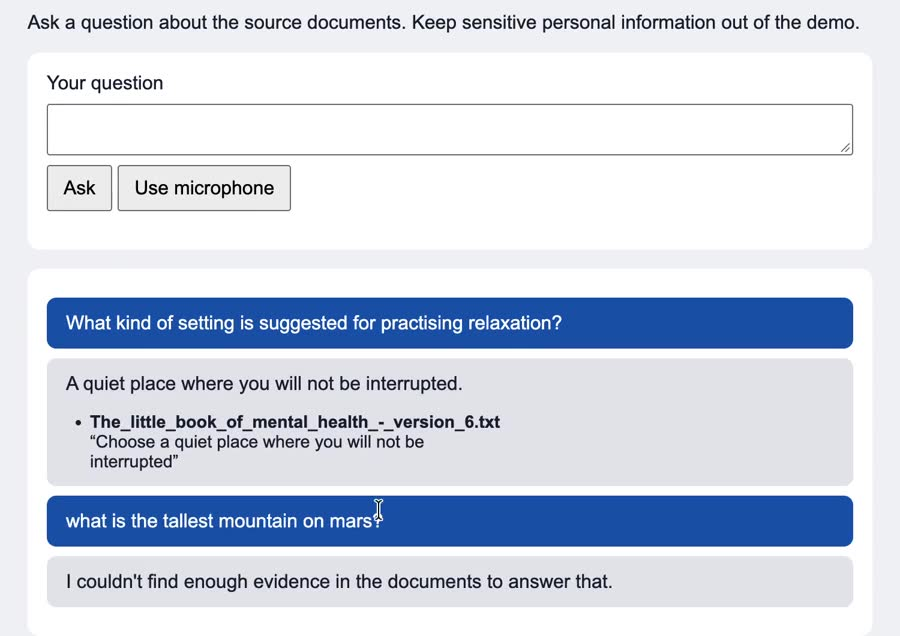

# Mental Health Buddy

A Flask RAG prototype for asking questions about two local wellbeing documents. The app combines keyword and semantic retrieval, sends up to two passages to Groq, and shows verified source quotations with the answer.

[Retrieval evaluation and results](docs/retrieval-evaluation.md) · [GitHub Actions](https://github.com/sumitgole011/Mental-Health-RAG-Bot/actions/workflows/source-checks.yml)

## Live demo

The bot answers a question about the booklet with a source quote, then explains that the documents lack evidence for a question about Mars.

[Watch the 32-second demo (MP4)](docs/rag-bot-demo.mp4)



## Run locally

Use Python 3.12, Git, and a Groq API key. The first chat request downloads the MiniLM embedding model from Hugging Face if it is missing locally.

```bash
git clone https://github.com/sumitgole011/Mental-Health-RAG-Bot.git
cd Mental-Health-RAG-Bot
python3 -m venv .venv
source .venv/bin/activate
python -m pip install -r requirements.txt
cp .env.example .env
```

On Windows PowerShell, use `python -m venv .venv`, `.\.venv\Scripts\Activate.ps1`, and `Copy-Item .env.example .env` for the environment and copy steps.

Fill in `GROQ_API_KEY` in `.env`. The example uses `openai/gpt-oss-20b`. Set `GROQ_MODEL` to a model your Groq account can use in [JSON Object Mode](https://console.groq.com/docs/structured-outputs#json-object-mode) if you prefer a different model.

```bash
python app.py
```

Open [http://127.0.0.1:5000](http://127.0.0.1:5000) and type a question. The microphone option appears in browsers that support speech recognition. Set `ENABLE_TTS=1` in `.env` for optional speech output on a machine with a working local speech engine.

## Verify two chat requests

Use your configured Groq key for these live checks. You can ask the same questions in the browser or run the commands below.

**Question covered by the booklet**

```bash
curl --fail-with-body -sS http://127.0.0.1:5000/chat \
  -H 'Content-Type: application/json' \
  -d '{"message":"What kind of setting is suggested for practising relaxation?"}'
```

Look for a short answer and an exact supporting quote from `The_little_book_of_mental_health_-_version_6.txt` in `sources`. This question is also in the [retrieval pilot](evaluation/fresh_questions.json).

**Question outside the documents**

```bash
curl --fail-with-body -sS http://127.0.0.1:5000/chat \
  -H 'Content-Type: application/json' \
  -d '{"message":"What is the tallest mountain on Mars?"}'
```

Expected `response` is `I couldn't find enough evidence in the documents to answer that.` with an empty `sources` list.

## How the chat works

1. [retrieval.py](retrieval.py) loads UTF-8 text from `Doc/` and combines TF-IDF and MiniLM similarity rankings.
2. [app.py](app.py) gives the question and top two passages to Groq and asks for a JSON answer with supporting quotations.
3. The server checks each quotation against the original retrieved passage and assigns its source filename and character offsets. If the reply lacks verifiable citations, the API returns the evidence fallback.
4. The browser renders the answer and its quotations together. Recent turns live in the browser tab and are sent with each request.

`POST /chat` accepts JSON with a `message` string and an optional `history` list of up to four recent `user` or `assistant` messages. A successful response has a `response` string and a `sources` array with `source`, `quote`, `start_index`, and `end_index` for each citation. Offsets use zero-based Python character indices in the loaded UTF-8 text. `GET /` serves the chat page.

## Run offline tests

```bash
python -m pip install -r requirements-retrieval-test.txt
python -m unittest discover -s tests -v
```

The tests exercise the Flask routes, Groq request format, citation checking, abstention, and provider errors through a simulated HTTP transport. They also cover document ingestion and retrieval with deterministic vectors.

## Safety, privacy and responsible use

This is an **educational AI prototype**, not a therapist, medical device, crisis-response service or substitute for qualified mental-health care. Responses can be inaccurate or inappropriate, and retrieval does not guarantee factual correctness. Do not use this application to make diagnosis or treatment decisions. In an immediate crisis, contact local emergency services or an appropriate crisis-support provider.

Avoid entering personally identifying, medical or other sensitive information into the demo. Before any real-world deployment, review third-party model data handling, storage and retention, access controls, content-safety behavior, and escalation paths. No clinical validation is claimed.

## Experimental speech script

`speaking_bot.py` is a separate prototype for voice input and tone classification. Use `app.py` for the supported setup and chat checks above.
